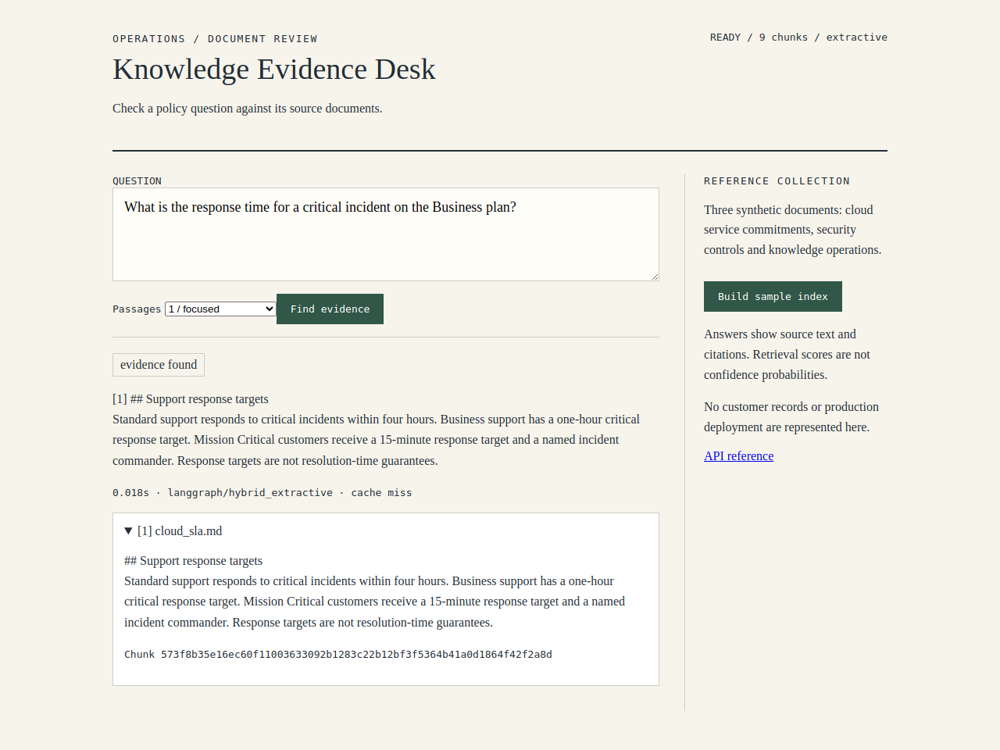
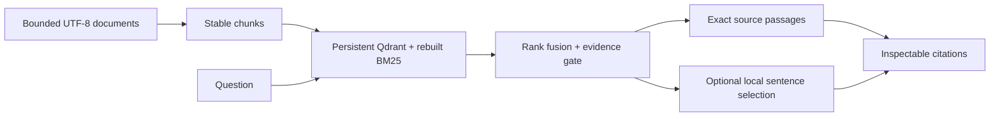

# Knowledge Evidence Desk

[](https://github.com/saintedwind/advanced-rag-copilot/actions/workflows/validation.yml)

A reproducible document-retrieval portfolio by Peyman Gholamhosseini. Ask questions about service commitments and inspect the source passages behind the result.



[Mobile capture](reports/desk-mobile.png) | [Verified CI run](https://github.com/saintedwind/advanced-rag-copilot/actions/runs/38380058365)

## What runs

- FastAPI desk and API, Qdrant local persistence, FastEmbed dense retrieval and Unicode BM25, combined with weighted reciprocal rank fusion.
- Stable content-derived chunk IDs; re-ingestion replaces the selected corpus and removes stale chunks. BM25 is rebuilt from persisted payloads after restart.
- A cosine threshold gates retrieval. Its value is a heuristic, **not calibrated confidence**.
- Default **extractive** mode returns source passages without a language-model call. Optional **local** mode asks a loopback llama.cpp model to select numbered source sentences; sentence embeddings rank the candidates, then the server renders those exact sentences and validates indices and completion status.
- LangGraph coordinates a bounded retrieval/normalization retry and synthesis. This is not autonomous reasoning or HyDE.
- Exact-query in-memory cache (128 entries), invalidated on ingestion. This is **not semantic caching**.
- Optional FlashRank; disabled by default. If unavailable, retrieval order is used.

## A two-minute review

1. Build the sample index and ask: **What is the Business plan critical response target?** Inspect the source's one-hour target and its distinction from resolution guarantees.
2. Ask: **What is the capital of Argentina?** The desk should abstain instead of treating an unrelated policy as an answer.
3. Repeat the supported question: inspect the exact-query cache hit. Re-index and verify that the cached result is invalidated.
4. Restart the service: the persisted vectors and rebuilt lexical index should still be available.

Measured development checks: 19 behavioral/boundary tests; 11/11 live extractive checks; 10/11 optional small-local-model checks. These are synthetic smoke checks, not general accuracy claims. [Full evidence and remaining limits](reports/validation.md).

## Pipeline



## Run locally

Python 3.12 or newer. First startup downloads the embedding model; subsequent runs reuse `.runtime/models`.

```sh
python -m venv .venv
# Activate the environment for your shell.
python -m pip install -e ".[dev]"
uvicorn src.app.api:app --host 127.0.0.1 --port 8000
```

Open http://127.0.0.1:8000 and select **Build sample index**. API documentation: `/docs`.

```sh
curl -X POST http://127.0.0.1:8000/ingest -H "Content-Type: application/json" -d '{}'
curl -X POST http://127.0.0.1:8000/query -H "Content-Type: application/json" -d '{"query":"What is the Business plan critical response time?","top_k":3}'
python -m pytest -q
```

Docker: `docker compose up --build` uses local Qdrant persistence and binds the host port to loopback. Allow time for the initial model download.

## Optional real local language model

Start an OpenAI-compatible llama.cpp server on **127.0.0.1:8081**, with a model supporting structured output. Set `LLM_PROVIDER=local` before starting the desk. No paid API or API key is used. Requests are limited to 96 output tokens and 3,000 context characters. Source selection can still be semantically wrong even when its citations are valid; review the original source.

## Boundaries and evidence

The three included documents are **synthetic**, not customer policies. The default embedding model is English-oriented; Persian token normalization is implemented but Persian retrieval quality is not claimed. This is a local single-process demonstration, not a hardened multi-tenant production service. No authentication, distributed cache or audited access control is included. Do not expose the service publicly or index confidential data without adding these controls.

Ingestion is restricted to `SOURCE_ROOT`, UTF-8 Markdown/text, 200 files, 1 MB per file and 10 MB total. Ingestion replaces the corpus, rather than appending to it. A failed database write can leave a partial index; rebuild from the source directory. The exact-query cache is not persisted. Changing the embedding model requires a new collection/index.

See `reports/validation.md` for measured results and remaining limits. Unit tests use deterministic embeddings and must not be reported as neural retrieval evaluation. Real embedding and live HTTP checks are recorded separately.

## Design choices

The project prioritizes inspectable evidence over polished unsupported answers. Provider failures return `generation_unavailable` with low confidence; no result is labeled high confidence merely because retrieval found a passage. The UI inserts user/model/source content as text, never HTML.

MIT license. Embedding weights and optional runtime/model licenses remain their respective authors' licenses.
